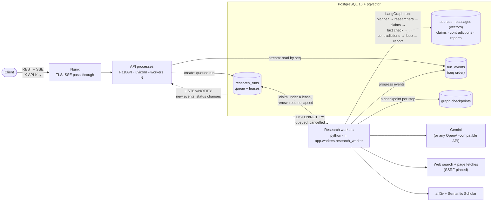

# ResearchMind

A multi-agent AI research system that decomposes complex questions, researches them in parallel with specialized agents, extracts and verifies claims, detects contradictions, and produces citation-backed reports with confidence scores.

## Quick Start

### With Docker (fresh clone, nothing else to install)

Needs [Docker](https://docs.docker.com/get-docker/) and a
[Google AI Studio](https://aistudio.google.com) API key. This runs the
production layout on your machine: Nginx, the API, two research workers, and a
local PostgreSQL with pgvector.

```bash
git clone <this repository> researchmind && cd researchmind
cp .env.example backend/.env
# In backend/.env set GEMINI_API_KEY, and API_KEY to any secret clients will send.

docker compose -f docker-compose.prod.yml -f docker-compose.localdb.yml up -d --build

curl http://localhost:8080/ready
# => {"status": "ready", "checks": {"database": "ok", ...}, "runs": {"queued": 0, "running": 0}, "listening": true}
```

Port 8080 taken? Run with `HTTP_PORT=8090` (any free port) in front of the
command.

Then try the [API](#research-api-m4-m6-m8) on `http://localhost:8080`. Check
the whole deployment with the smoke tests (they start real runs, so they spend
a few model calls):

```bash
python backend/scripts/smoke_test.py --base-url http://localhost:8080 --api-key <API_KEY> api
python backend/scripts/smoke_test.py --base-url http://localhost:8080 --api-key <API_KEY> restart \
    --kill "docker compose -f docker-compose.prod.yml -f docker-compose.localdb.yml kill -s SIGKILL worker" \
    --start "docker compose -f docker-compose.prod.yml -f docker-compose.localdb.yml up -d --no-deps worker"
```

The second kills every worker in the middle of a run and starts new ones; the
run resumes from its last checkpoint once the dead workers' lease lapses
(`RUN_LEASE_SECONDS`, 60 s by default) and finishes without redoing the steps
that were done. Stop the stack with `docker compose -f docker-compose.prod.yml -f docker-compose.localdb.yml down`
(add `-v` to delete the database).

To use your own database (Supabase, RDS) instead, set `DATABASE_URL` in
`backend/.env` and leave out `-f docker-compose.localdb.yml`; the `migrate`
service applies the migrations either way. Deploying to AWS:
[docs/DEPLOY_AWS.md](docs/DEPLOY_AWS.md).

### The web UI

A dark-theme React app in `frontend/` (see [frontend/README.md](frontend/README.md)):
start runs, follow them live, read reports, explore the evidence graph.

```bash
cd backend && uvicorn app.main:app --port 8000 --timeout-graceful-shutdown 5   # the API
cd frontend && npm install && npm run dev                                     # http://localhost:5173
```

### Without Docker (development)

#### Prerequisites
- Python 3.11+
- A [Supabase](https://supabase.com) project (free tier works), or any
  PostgreSQL 16 with pgvector
- A [Google AI Studio](https://aistudio.google.com) API key

#### Setup

1. **Clone and install dependencies:**
   ```bash
   # Install backend
   cd backend
   pip install -e ".[dev]"

   # Install agents package
   cd ../agents
   pip install -e ".[dev]"
   ```

2. **Configure environment:**
   ```bash
   # backend/.env is read wherever you run from (a repo-root .env also works;
   # backend/.env wins). Only GEMINI_API_KEY is required; see .env.example
   # for every other setting.
   cp .env.example backend/.env
   ```

3. **Apply migrations** (once, and after pulling new ones):
   ```bash
   cd backend
   alembic upgrade head
   ```

4. **Run the API.** By default it also runs a research worker
   (`RUN_WORKER_IN_API=true`), so this one process is enough.
   ```bash
   cd backend
   uvicorn app.main:app --reload --port 8000 --timeout-graceful-shutdown 5
   ```
   Keep `--timeout-graceful-shutdown`: an open event stream lasts until its run
   ends, and uvicorn waits for open connections before the app's shutdown runs,
   so without it stopping the server waits for every streamed run to finish.
   Without `DATABASE_URL` the API still starts, but the research endpoints
   answer 503.

   To run research in separate processes instead, set `RUN_WORKER_IN_API=false`
   and start as many workers as you like:
   ```bash
   cd backend
   python -m app.workers.research_worker
   ```

5. **Verify:**
   ```bash
   curl http://localhost:8000/health
   # => {"status": "healthy"}
   curl http://localhost:8000/ready
   # => {"status": "ready", "checks": {"database": "ok", ...}, "runs": {...}, "worker": {...}}
   ```
   Interactive API docs are at http://localhost:8000/docs.

### Run a research question

From the repository root, with `GEMINI_API_KEY` set in `backend/.env`:

```bash
# One question: prints the cited markdown report, usage, and a grounding check
python backend/scripts/run_mvp.py "Is RAG better than fine-tuning for enterprise QA?"

# Deep, academic, or decision mode: specialist researchers, fact-checked claims,
# contradiction detection, gap-filling rounds, and a confidence score (more model
# calls, so slower on the free tier); decision mode ends in a recommendation
python backend/scripts/run_mvp.py --mode deep "PostgreSQL or MongoDB for an AI SaaS in 2026?"
python backend/scripts/run_mvp.py --mode decision "PostgreSQL or MongoDB for an AI SaaS in 2026?"

# Seed eval: runs agents/researchmind_agents/evals/seed.jsonl and writes
# results to agents/researchmind_agents/evals/results/
python backend/scripts/run_mvp.py --seed

# Verification eval (M5): the fact checker on 20 hand-labelled claims
# (one small model call each; no search, embeddings, or database)
python backend/scripts/eval_verification.py

# Contradiction eval (M6): the detector on 15 seeded cases (14 contradictions,
# 3 cases with none); one embedding call and a model call or two per case
python backend/scripts/eval_contradictions.py
```

On Gemini's free tier a run takes about 1.5–2 minutes: embeddings are capped at
30k tokens per minute, so the run waits out the rate limit (up to
`LLM_MAX_RETRY_DELAY`) instead of dropping passages. When Gemini answers
503 "high demand", calls retry after `LLM_OVERLOAD_RETRY_DELAY` (10 s, doubling).
If the model still cannot write the report, the run stores an extractive report
that quotes passages; the seed eval counts that as a failure, since it does not
test the synthesizer.

`--store memory` runs with no database. `--store db` persists the run, sources,
passages, events, usage, and report to `DATABASE_URL`; apply migrations first
with `cd backend && alembic upgrade head`. The default, `auto`, uses the
database when `DATABASE_URL` is set.

### Run the benchmark (M7)

One command compares ResearchMind with a closed-book LLM (one prompt, no
retrieval) and a single-agent RAG baseline (one search, one cited answer) on 40
questions, 10 per mode, and writes the comparison table for the project report:

```bash
python -m researchmind_agents.evals run --suite default

# A slice: one mode, or a few questions; --systems picks a subset
python -m researchmind_agents.evals run --suite default --modes quick --limit 3

# Continue an interrupted run (results are saved after every answer)
python -m researchmind_agents.evals run --resume agents/researchmind_agents/evals/results/<run>

# The whole harness on scripted fakes: no network, no API keys (what CI runs)
python -m researchmind_agents.evals run --suite offline
```

Each run gets its own directory under `agents/researchmind_agents/evals/results/`:
`results.md` (the tables), `results.json` (aggregates and one row per answer),
`spot_check.jsonl`, `meta.json`, and `details.jsonl` (every judged sentence; not
committed). Answers are scored by an LLM-as-judge with versioned prompts
(`eval_support/v1`, `eval_coverage/v2`), separate from ResearchMind's own fact
checker; set `EVAL_JUDGE_MODEL` to judge with a different model. Metrics:
faithfulness, citation precision, fabricated citations, hallucination rate,
completeness, relevance, Precision@K/Recall@K/MRR against hand-labelled gold
sources, task completion, rounds, latency, tokens, and cost. Definitions are at
the end of every `results.md` and in `evals/metrics.py`.

Check the judge by hand: set `human_stance` (`supports`, `contradicts`, or
`neutral`) on the lines of `spot_check.jsonl`, then

```bash
python -m researchmind_agents.evals agreement agents/researchmind_agents/evals/results/<run>
```

The CLI gets its settings (keys, models) from `backend/.env` through an entry
point the backend registers, so install the backend first (`pip install -e backend`).
A full run makes over a thousand model calls (a quick-mode question took 18 calls and
about 3 minutes in the first live test); on Gemini's free tier expect several hours,
and use `--resume` if a daily quota stops it.

### Run Tests
```bash
# Both packages from the repo root
pytest

# Or per package
cd backend && pytest
cd ../agents && pytest
```

Tests mock every LLM, search, and HTTP call, so the suite runs with no API keys
and no database. Tests needing live services are marked `integration` and skip
unless their environment variable is set:

```bash
# Verifies the Alembic migration against a real PostgreSQL + pgvector
DATABASE_URL=postgresql+asyncpg://... pytest -m integration
```

### Run Quality Checks
```bash
ruff check .
mypy backend/app agents/researchmind_agents
```

## LLM providers

The LLM layer is provider-agnostic; the choice is config, not code.

| `LLM_PROVIDER` | Transport | Keys |
|---|---|---|
| `gemini` (default) | `google-genai` | `GEMINI_API_KEY` |
| `openai_compatible` / `openrouter` / `groq` | OpenAI chat-completions over httpx | `LLM_BASE_URL`, `LLM_API_KEY` |

Every call goes through the wrapper, which handles retries, Pydantic-validated
structured output (re-prompting with the validation error on failure), and
writes a row to `llm_usage` with tokens, latency, and USD cost. Cost is
computed from `LLM_PRICE_PER_1M_*` or a built-in table, and is `0.0` on free
tiers rather than estimated.

Embeddings always use `google-genai`, independently of `LLM_PROVIDER`, so an
OpenAI-compatible LLM can be paired with Gemini embeddings. The default model is
`gemini-embedding-001`, asked for 768-dimensional vectors to match the
`vector(768)` column (`text-embedding-004` was shut down on 2026-01-14).

## Research graph

| Mode | Researchers | Verified, with contradictions | Rounds | Report |
|---|---|---|---|---|
| `quick` | web | no | 1 | cited passages |
| `deep` | web, technical, market | yes | up to `MAX_ITERATIONS` (3) | key findings, confidence |
| `academic` | web, technical, market, academic (favoured) | yes | up to 3 | key findings, confidence |
| `decision` | web, technical, market (favoured), academic | yes | up to 3 | plus a required recommendation |

```
quick:     START → planner ─(branch per sub-question)→ web_researcher → synthesizer → END

deep /     START → planner ─(branch per new sub-question, to its domain's researcher)→
academic /         web | technical | market | academic researcher
decision:          → claim_extractor → fact_checker → contradiction_detector
                   → sufficiency_checker ─(gaps, and another round allowed)→ planner
                                         └─(enough, or no round allowed)→ synthesizer → END
```

- **Planner** — splits the question into sub-questions with search queries
  (2–5 in `quick`, 4–8 in the other modes), and tags each with the researcher
  that should handle it (`web`, `technical`, `market`, `academic`, as the mode
  allows). In a gap-filling round it gets the coverage so far and the gaps, and
  proposes at most `PLANNER_MAX_GAP_SUB_QUESTIONS` *new* sub-questions; one that
  fills a sub-question's gap counts toward that sub-question.
- **Web, technical, and market researchers** — one pipeline with different
  guidance: search, let the model pick which results to read (technical prefers
  documentation and benchmarks; market prefers pricing pages and industry
  reports), fetch pages, store each as a source (de-duplicated across branches),
  then chunk and embed its text as passages.
- **Academic researcher** — searches arXiv and Semantic Scholar (over httpx; no
  extra dependency) and stores each chosen paper's title and abstract as a
  source. If the indexes return nothing (Semantic Scholar's keyless pool is
  often rate-limited), it falls back to web search that prefers journals,
  archives, and university sites.
- **Claim extractor** — reads the most relevant passages per sub-question and
  lists atomic claims, each tied to the passages it came from. A claim without
  a valid passage is dropped, so every claim links to stored evidence.
- **Fact checker** — checks each claim against its own passages and the most
  similar passages from *other* sources. The model gives a verdict
  (`supported`, `weak`, `mixed`, `unsupported`) and a stance per passage; code
  makes the verdict agree with the stances and computes the confidence.
- **Contradiction detector** — pairs usable claims that are similar
  (`CONTRADICTION_MIN_SIMILARITY`) or that the fact checker linked (one claim's
  passage contradicts the other), groups them by topic, and asks the model which
  claims cannot both be true and why: `conditions`, `date`, `version`,
  `dataset`, `methodology`, `definition`, or `unexplained`. Code decides from the
  cause whether the contradiction is *resolved* (a difference in scope, so both
  claims can hold — `CONFIDENCE_RESOLVED_CAUSES`); unresolved ones lower the
  report's confidence.
- **Sufficiency checker** — rules first: every sub-question needs
  `SUFFICIENCY_MIN_CLAIMS_PER_SUB_QUESTION` usable claims from
  `SUFFICIENCY_MIN_SITES_PER_SUB_QUESTION` independent sites. When the rules
  pass, the model judges whether the claims answer the question and may name
  missing aspects. Gaps send the run back to the planner, unless the run is at
  `MAX_ITERATIONS`, out of research budget, or past its mode's
  `LOOP_DEADLINE_SECONDS`. Each later round researches, extracts, checks, and
  compares only its new material.
- **Synthesizer** — in `quick` mode, writes from retrieved passages, citing
  sources `S1`, `S2`, …. In the verified modes, writes only from usable verified
  claims, citing claims `C1`, `C2`, …; each statement's sources are those of its
  claims, and the report lists the key findings with verdicts and confidence,
  and the contradictions between them (`X1`, …) with their likely causes. In
  `decision` mode it must also write a recommendation; if none can be grounded,
  the report says so. Unknown or missing citations get one retry, then the
  statement is dropped. Markdown is rendered from the validated JSON, so every
  citation points to a stored source.
- **Budget** — `MAX_TOKENS_PER_RUN` / `MAX_COST_PER_RUN_USD` are enforced per
  run. Research stops early to leave `BUDGET_SYNTHESIS_RESERVE` for the report;
  if the cap is fully spent, the report quotes passages without a model call.
  A run always ends with a stored report.

### Scoring (no number comes from a model)

Formulas and weights are documented in
`agents/researchmind_agents/reliability.py`; every weight is a setting
(`RELIABILITY_*`, `CONFIDENCE_*`).

- **Source reliability (0–1)** — base score by source type (peer-reviewed,
  standards bodies, official docs, government > academic, preprints, news >
  reference, code repositories, company blogs > personal blogs, unknown >
  forums), times a recency factor, plus citation and methodology bonuses for
  papers. Types come from the versioned list in
  `agents/researchmind_agents/data/domains.json` plus TLD, host, and path rules.
- **Claim confidence (0–1)** — `verdict weight × corroboration × agreement`.
  Each site counts once; independent supporting sites combine by noisy-OR (one
  source alone reaches at most 0.8 × its reliability), and contradicting
  sources lower the agreement ratio.
- **Report confidence** — the cited claims' confidence, weighted by how many
  statements cite each, reduced for sub-questions without a verified claim and
  by `CONFIDENCE_CONTRADICTION_PENALTY` per unresolved contradiction (up to the
  cap).

## Research API (M4, M6, M8)

Every `/api/v1/research` route needs the `X-API-Key` header (when `API_KEY` is
set) and counts against a per-key rate limit. Errors always look like
`{"error": {"code": "...", "message": "...", "details": ...}}`.

| Method | Path | Purpose |
|---|---|---|
| POST | `/api/v1/research` | Start a run: `{question, mode?, user_context?, max_sources?}` → 202 `{run_id, status, links}` |
| GET | `/api/v1/research` | List runs, newest first: `?limit=&offset=&status=&mode=` |
| GET | `/api/v1/research/{id}` | Status, plan, sub-questions, and progress per step |
| GET | `/api/v1/research/{id}/events` | Server-Sent Events: replay, then live, until the run ends |
| GET | `/api/v1/research/{id}/report` | Report JSON + markdown; in the verified modes, key findings with verdicts, contradictory evidence, and an overall confidence, plus a recommendation in `decision` (409 while running, 404 if none) |
| GET | `/api/v1/research/{id}/graph` | Evidence graph for a React Flow view: `{nodes, edges}` (see below); available while the run is in progress |
| GET | `/api/v1/research/{id}/sources` | Stored sources with type, reliability score, publication date, passage counts, and whether the report cites them |
| GET | `/api/v1/research/{id}/usage` | Calls, tokens, cost, and latency — total, per agent, per model |
| POST | `/api/v1/research/{id}/cancel` | Cancel a queued or running run (409 if it already ended) |
| POST | `/api/v1/research/{id}/resume` | Resume a failed run from its last checkpoint → 202 (409 unless it failed) |
| DELETE | `/api/v1/research/{id}` | Cancel if active, then delete the run and all its data (204) |

```bash
API=http://localhost:8000          # http://localhost:8080 for the Docker stack
KEY="X-API-Key: your-api-key-for-clients"

# Start a run (mode: quick | deep | academic | decision)
RUN=$(curl -s -H "$KEY" -H "Content-Type: application/json" \
  -d '{"question": "PostgreSQL or MongoDB for an AI SaaS?", "mode": "decision",
       "user_context": {"team": "3 backend engineers"}}' \
  $API/api/v1/research | python -c "import sys, json; print(json.load(sys.stdin)['run_id'])")

curl -N -H "$KEY" $API/api/v1/research/$RUN/events     # live progress (SSE)
curl -s -H "$KEY" $API/api/v1/research/$RUN            # status and progress per step
curl -s -H "$KEY" $API/api/v1/research/$RUN/report     # once it completes
curl -s -H "$KEY" $API/api/v1/research/$RUN/sources    # sources with reliability scores
curl -s -H "$KEY" $API/api/v1/research/$RUN/graph      # evidence graph
curl -s -H "$KEY" $API/api/v1/research/$RUN/usage      # tokens and cost per agent
curl -s -H "$KEY" "$API/api/v1/research?status=completed&limit=10"

curl -s -X POST -H "$KEY" $API/api/v1/research/$RUN/cancel
curl -s -X POST -H "$KEY" $API/api/v1/research/$RUN/resume   # a failed run only
curl -s -X DELETE -H "$KEY" $API/api/v1/research/$RUN
```

**Evidence graph.** Nodes are `{id, type, label, meta}` with `type` one of
`question`, `sub_question`, `claim`, `passage`, `source` (IDs are
`<type>:<record id>`); claim nodes carry `verdict` and `confidence`. Edges are
`{id, from, to, type, meta}`: `decomposes` (question → sub-question,
sub-question → gap-filling follow-up, sub-question → claim), `supports` /
`contradicts` (passage → claim, from the fact checker), `contradicts` (claim →
claim, a detected contradiction, with `likely_cause` and `resolved` in `meta`),
and `cites` (passage → its source). The schema is `EvidenceGraph` in
`backend/app/schemas/graph.py` and in the OpenAPI docs.

**Events.** Each SSE event's `event:` is its type and its `id:` is the run's
event sequence number (`seq`, 1, 2, 3, ...). Types include `run_status`
(queued → running → completed / failed / cancelled), `agent_started`,
`agent_finished`, `search_completed`, `source_found` (with the source's type and
reliability), `claims_extracted`, `claim_verified` (verdict and confidence),
`contradiction_found` (claims, likely cause, resolved), `sufficiency_checked`
(the round's gaps and whether another round runs), `report_ready`, and `error`
(an agent hit a problem; the run continues). A resumed run's `run_status`
carries `"resumed": true` and its `attempt`, and a step its interruption cut
short gets an `agent_finished` with `"status": "interrupted"` before it runs
again. The stream closes after the terminal `run_status` — unless the run went
on (a failed run resumed through `/resume`), in which case it follows the run to
its next end. To resume after a dropped connection, send
`Last-Event-ID: <seq>` (browsers' `EventSource` does this itself) or
`?after=<seq>`. `EventSource` cannot send `X-API-Key`, so a web client should
use a fetch-based SSE client.

**Limits.** `MAX_QUESTION_CHARS`, `MAX_USER_CONTEXT_BYTES`,
`MAX_REQUEST_BODY_BYTES` (413), `MAX_SOURCES_LIMIT`; `RATE_LIMIT_REQUESTS` and
`RATE_LIMIT_RUNS` per `RATE_LIMIT_WINDOW_SECONDS` (429 with `Retry-After`);
each worker runs `MAX_CONCURRENT_RUNS` at once, and up to `MAX_PENDING_RUNS` may
be queued or running in total (503 beyond). Rate limits are per API process.
`CORS_ALLOW_ORIGINS` lists the browser origins allowed to call the API.

**Durability (M8).** Runs live in the database, not in a process. Creating a
run queues it; a worker (inside the API, or `python -m
app.workers.research_worker`, as many as you like) claims it under a lease and
renews the lease while it works. Every step of the graph is checkpointed to the
database before the next one starts, so:

* **A worker that dies** (crash, `SIGKILL`, lost host) stops renewing; once its
  lease lapses (`RUN_LEASE_SECONDS`), another worker resumes the run from its
  last checkpoint. Finished steps are not run again; in a parallel step only the
  branches that had not finished re-run, and rows they had stored are replaced,
  not duplicated. The resumed run's budget counts what earlier attempts spent.
  A run interrupted `MAX_RUN_ATTEMPTS` times is failed instead.
* **A worker that stops cleanly** (`SIGTERM`, a deploy) hands its runs back at
  once, so another worker picks them up without waiting for the lease.
* **A failed run** (for example, the model's daily quota ran out) can be resumed
  with `POST /{id}/resume`.
* **Cancelling** works from any API process: the run's worker, wherever it is,
  is told through PostgreSQL `LISTEN/NOTIFY` and stops within moments (at the
  latest at its next lease renewal).

Event streams also go through `LISTEN/NOTIFY`, so any API process streams a run
executed by any worker. Supabase's transaction pooler (port 6543) cannot
`LISTEN`: set `DATABASE_LISTEN_URL` to the session pooler (port 5432) or a
direct connection, or streams fall back to polling every
`SSE_POLL_INTERVAL_SECONDS`. Completed and cancelled runs drop their checkpoints;
failed ones keep them so they can be resumed.

**Tracing.** Set `LANGSMITH_TRACING=true` and `LANGSMITH_API_KEY` to send each
run to LangSmith as one trace (named `research:<mode>`, tagged with its
`run_id`) with a span per graph node.

## Architecture



* **API processes** validate requests, queue runs, and serve reads and event
  streams. They hold no run state, so any number can run behind Nginx or a load
  balancer.
* **Workers** take runs from the database (`research_runs` is the queue), run the
  LangGraph workflow from the `agents` package, and checkpoint every step. A
  worker can also run inside the API process (`RUN_WORKER_IN_API`), which is the
  one-container setup used in development.
* **PostgreSQL** is the only shared state: runs and their leases, evidence and
  vectors, the ordered event log the streams replay, and the checkpoints runs
  resume from. `LISTEN/NOTIFY` carries wake-ups between processes; everything
  still works by polling without it.
* **Package boundary:** `agents/` holds the graph, prompts, and tools and never
  imports the backend; `backend/` holds HTTP, database, and process lifecycle,
  and contains no prompts or agent logic (see `AGENTS.md`).

## Deployment

* **One machine (EC2 or any VM):** `docker compose -f docker-compose.prod.yml up -d`
  with `DATABASE_URL` pointing at a managed PostgreSQL. Scale with
  `API_PROCESSES` (uvicorn processes) and `WORKER_REPLICAS`.
* **Containers (ECS Fargate):** one image, two services (API and worker), a
  one-off migration task, an ALB in front.

Step-by-step for both, with RDS and Supabase, secrets, TLS, and logs:
[docs/DEPLOY_AWS.md](docs/DEPLOY_AWS.md). Logs are one JSON object per line,
with `run_id` and `worker_id` on every line written inside a run.

## Project Structure

- `backend/` — FastAPI REST API, database models, services
- `agents/` — LangGraph agent workflow, LLM wrapper, tools, prompts
- `frontend/` — React + Vite web UI (dark theme), talking to the API

## Milestones

- [x] **M0** — Foundation (scaffold, config, health endpoint)
- [x] **M1** — Data layer (SQLAlchemy models, Alembic migrations, pgvector)
- [x] **M2** — LLM and tool layer (provider-agnostic wrapper with usage/cost
      recording, embeddings, search with TTL cache, SSRF-guarded page extraction,
      vector search)
- [ ] **M3** — MVP graph (Planner → Web Research → Synthesizer)
- [x] **M4** — API and background jobs (REST API, SSE with resume, cancel,
      in-process job runner, API-key auth, rate limits, startup recovery)
- [x] **M5** — Specialized agents and verification (technical, market, and
      academic researchers; claim extraction; fact checking; deterministic
      source reliability and claim/report confidence; `deep` and `academic`
      modes). Live verification eval pending.
- [x] **M6** — Contradictions, loop, evidence graph (contradiction detector with
      likely causes; sufficiency check and gap-filling loop; `decision` mode;
      per-mode planner bounds and loop deadlines; `/graph` endpoint). Live
      contradiction eval and latency checks pending.
- [x] **M7** — Evaluation framework (40-question benchmark across the four
      modes; closed-book and single-agent RAG baselines; LLM-as-judge with
      versioned prompts and a spot-check sample; retrieval, answer-quality, and
      operations metrics; `python -m researchmind_agents.evals`). Live benchmark
      run pending.
- [x] **M8** — Hardening and deployment (database-backed run queue with worker
      leases; resume from LangGraph checkpoints after a worker dies, a clean
      shutdown, or `POST /resume`; `LISTEN/NOTIFY` for streams and cancels across
      processes; SSRF connections pinned to the vetted address; configurable
      CORS; `run_id`/`worker_id` on every log line; multi-stage Dockerfile,
      Nginx, production compose, AWS guide, smoke tests)

## License

MIT
